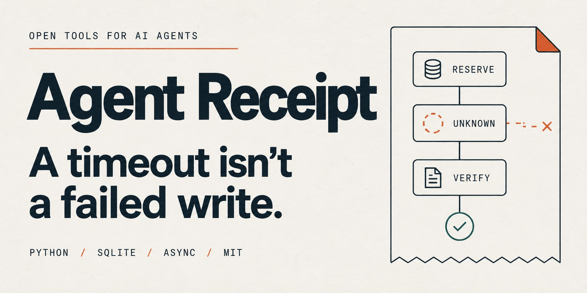
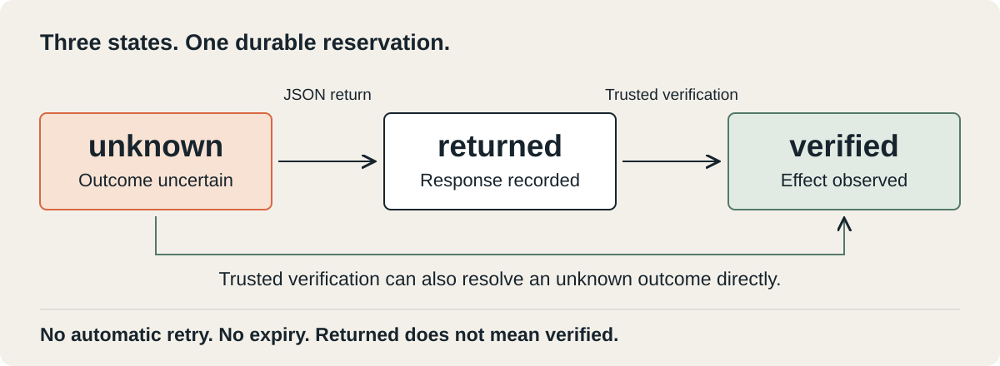

# Agent Receipt

**Keep a lost tool response from becoming a duplicate write.**

[](https://github.com/xMaxos/xMaxos-agent-receipt/actions/workflows/tests.yml)

**Python 3.11+ · Sync + async · SQLite · No runtime dependencies · MIT**

[Try the demo](#try-it) · [Understand the states](#what-the-states-mean)
· [Inspect the evidence](VALIDATION.md) · [Contribute](CONTRIBUTING.md)

If a tool commits a change and its response disappears, retrying can repeat the change.
Agent Receipt records a dispatch reservation **before** invoking the tool. Further calls
with the same operation identity return the recorded response or an explicit `unknown`
outcome. A trusted, read-only verifier can resolve the uncertainty.

For agent hosts and tool developers. No model requests or telemetry are made by the
library. This is an early reference implementation with a conservative local
dispatch policy; it does not guarantee exactly-once remote effects.

**Looking for testers and contributors:** run the demo, report a reproducible failure,
or help build a real adapter with authoritative outcome lookup.
[Find a focused starting task →](CONTRIBUTING.md)

## Try it

Clone and run a complete local example. No API key or model account is needed:

```sh
git clone https://github.com/xMaxos/xMaxos-agent-receipt.git
cd xMaxos-agent-receipt
python examples/async_quickstart.py
```

The demo cancels a tool after a real local write, restarts the guard, blocks another
dispatch and verifies the existing record:

```json
{
  "after_cancellation": "unknown",
  "after_verification": "verified",
  "actual_external_effects": 1
}
```

**The tradeoff:** a crash before dispatch can leave work unfinished and blocked.
An empty lookup does not make a retry safe; the original write could still arrive.

<details>
<summary>Development checks and installation</summary>

From this source directory:

```sh
python -m unittest discover -s tests -v
python examples/crash_lab.py --trials 10 --output evidence
python examples/quickstart.py
python examples/async_quickstart.py
```

Install locally with `python -m pip install .`, or build and install a wheel:

```sh
python -m pip wheel . --no-deps --wheel-dir dist
python -m pip install dist/agent_receipt-0.2.0-py3-none-any.whl
```

The distribution name is provisional; this release has not been published to PyPI.

</details>

## Integration

The **host**, not the model, assigns and persists a logical operation key. Retries of
the same intended action must keep that key across turns, workers and restarts.
Two intentional identical actions need different keys. Do not use an argument hash
as the action identity; identical arguments can represent two legitimate actions.

```python
from agent_receipt import Guard, Request, Observation

guard = Guard("agent-receipts.sqlite")
request = Request(
    scope="tenant-42:inventory-production",
    key="workflow-761:create-item-1",       # persisted by the host workflow
    tool="inventory.create:v1",           # include semantic tool version
    arguments={"sku": "demo", "quantity": 1},
)

def invoke(req):
    # Your existing API adapter. Use the frozen request, not mutable outer inputs.
    # Correlate the backend effect with req.token; use backend idempotency if supported.
    return inventory.create(**req.arguments, client_reference=req.token)

receipt = guard.execute(request, invoke)
agent_tool_output = receipt.to_dict()
```

`inventory` above represents an application-owned adapter, not a bundled API client.
The runnable [quickstart](examples/quickstart.py) uses a separate local SQLite backend.

After an uncertain outcome, perform an authoritative lookup correlated to the same
operation token **and** validate that the complete intended effect matches:

```python
def verify(req):
    item = inventory.find_by_client_reference(req.token)
    if item and inventory.matches_complete_request(item, req.arguments):
        return Observation(applied=True, result={"id": item.id},
                           evidence=f"inventory-item:{item.id}")
    return Observation()  # missing, stale or partial is inconclusive

receipt = guard.reconcile(request, verify)
```

The verifier is trusted integration code. The library cannot validate whether the
external observation is true, read-only, sufficiently consistent or complete. An
LLM saying "done" is not evidence. Include tenant, destination and all meaningful
inputs in the request identity; do not switch endpoints behind the same adapter.

## Async tools

Version 0.2.0 adds native asyncio callbacks. SQLite work runs in worker threads;
your async adapter runs on the caller's event loop and keeps its context.

```python
import asyncio

# Inside your async application's startup:
guard = await asyncio.to_thread(Guard, "agent-receipts.sqlite")

async def invoke(req):
    return await inventory.create(**req.arguments, client_reference=req.token)

receipt = await guard.aexecute(request, invoke)
# A verifier declared with async def can be passed to guard.areconcile().
stored = await guard.aget(request)
```

`aexecute` and `areconcile` accept `async def` functions (including partials) or
objects with `async def __call__`. Wrap a synchronous factory returning an awaitable
in an `async def` adapter. Callbacks must still return strict JSON / `Observation`,
respectively. The sync and async APIs share the same journal and operation identities.

`CancelledError` propagates; ordinary callback exceptions produce an uncertain
receipt. Cancellation **never releases a reservation**. Cancellation during a
database await does not stop the worker: its reservation or result may still commit.
Cancellation during a remote request does not prove the effect stopped. An outer
`asyncio.timeout()` therefore must not trigger a fresh operation key or blind retry.

The constructor is synchronous: create it before starting the event loop or use
`asyncio.to_thread` as above. For an existing synchronous adapter, use
`await asyncio.to_thread(guard.execute, request, sync_adapter)`.

Run [the async demo](examples/async_quickstart.py) to cancel a task after a real local
write, restart the guard, block replay and verify the effect. No API key is needed.

## What the states mean



| State | Meaning | Host behavior |
|---|---|---|
| `unknown` | A dispatch was reserved; it may still be running, have completed, or never have started | Verify the effect. Do not repeat the action. |
| `returned` | A JSON response was durably recorded | Inspect the response, including any tool error. This does not assert business success. |
| `verified` | A trusted verifier observed the complete intended effect | Inspect the recorded result and evidence reference. |

`execute` / `aexecute` invoke the callback at most once for each `(scope, key)` in one intact
journal. A successful repeated call returns the cached receipt with `replayed=True`.
Reusing a key with different arguments or a different tool raises `RequestConflict`.
JSON object ordering is ignored; values, types and array order are not.

There is **no automatic retry, lease expiry, reset, deletion or "not found means
safe to retry" path**. An empty read may race a delayed write. If the process dies
after reservation but before dispatch, the operation can remain unknown forever.
This is the deliberate cost of this conservative policy. Production adapters that
need automatic recovery should use backend-enforced idempotency or authoritative
terminal cancellation; this version does not implement those mechanisms.

## Agent integration boundaries

- Install this at the host tool-dispatch boundary. Do not let a model bypass it by
  assigning a fresh key to the same unresolved operation.
- Re-check authorization before every API access and before returning cached data.
  A scope is a namespace, not an authentication mechanism.
- All workers protecting the same operations must share this same local database.
  Separate copies, restored old backups and lost journals remove that protection.
- Use `execute` for synchronous callbacks and `aexecute` for asyncio callbacks.
  Both require strict JSON results. Cancellation does not prove an action stopped.
- SDK/HTTP retries **inside** the callback are outside the guard. Disable unsafe
  internal retries or use the provider's idempotency contract.
- Errors during invocation or result serialization produce `unknown`. Exceptions'
  messages are not stored. Validate inputs before calling; instrument your adapter
  if you need sanitized diagnostics. Process-control exceptions propagate.
- Verification errors propagate. Database errors propagate and never authorize a
  retry. A receipt is not an authorization, sandbox or security boundary.

## Evidence

[Raw runs](evidence/fault-results.json) and the [readable report](evidence/fault-results.md)
contain 120 local executions: six scenarios, two strategies, ten repetitions.
The naive baseline retries ambiguous failures once; this is not a comparison against
other recovery libraries.

| Measured outcome | Naive retry | Agent Receipt |
|---|---:|---:|
| Extra effects across all 60 runs per strategy | 30 | 0 |
| Missing effects | 0 | 10 |
| Outcomes left explicitly unknown | 0 | 10 |

The ten missing effects are the crash-before-commit case. We include them rather than
reporting only the duplicate reduction. Process crashes use real subprocess exits;
effects commit to a separate SQLite database. The delayed-write case uses thread
barriers, not sleeps. These are deterministic correctness experiments, **not** a
statistical estimate of real-world reliability or a benchmark of LLM intelligence.

See [VALIDATION.md](VALIDATION.md) for the exact tested environment and scope.

## Live AI-agent integration test

Seven live Codex agent runs on version 0.1.0 (including one pilot) used the configured `gpt-6-astra`
model and a real stdio MCP connection. All passed the effect/state checks. The agent
recovered an already-committed write, respected a durable reservation after restart,
left an unconfirmed action explicitly unresolved, and created two distinct intended
actions with identical parameters. Final statements were also reviewed against the
tool evidence. The model selected its own tool sequence; it was not a scripted policy.
The new async API has separate offline cancellation/concurrency coverage; these
historical live runs do not exercise it.

The comparison agent without the guard also handled its timeout safely by inspecting
the effect. This small sample demonstrates integration, **not superiority** over an
unguarded agent. Effects were real local test records; failures were injected, not
outages of a production cloud API. The host exposed only authorized action slots.

[Live report](evidence/live-agents.md) · [Task and tool traces](evidence/live-agents.json)
· [Pilot](evidence/live-pilot.json)

To reproduce with your own authenticated Codex CLI, explicitly opt in:

```sh
python scripts/live_agent_eval.py --model YOUR_AVAILABLE_MODEL
```

This uses model/account quota. It does not run in ordinary tests or CI. Raw CLI logs
stay in ignored `.live-runs/`; the exported report contains only synthetic prompts,
task responses, controlled tool traces and usage. No credentials are exported.

## Limits and storage

This does not guarantee exactly-once remote effects, completion, protection against
a malicious agent, correctness of the tool response, or correctness of a verifier.
One callback can itself perform several effects. Network partitions, power loss,
real hosted side-effect APIs, network filesystems and multiple machines are untested.
Use a local disk and a stable journal path; keep the journal as long as operations
can be replayed. Do not delete unresolved records to make a workflow move forward.

Arguments are stored only as a SHA-256 fingerprint, not plaintext. Fingerprints of
guessable inputs are not anonymization. Results, evidence references, scope, key and
tool names are plaintext. Protect the file with host OS permissions and encryption
as needed; avoid secrets in identifiers. No retention or encryption service is included.

## Related work and contribution

- [AWS: Making retries safe with idempotent APIs](https://aws.amazon.com/builders-library/making-retries-safe-with-idempotent-APIs/)
  explains client intent IDs and retry ambiguity.
- [MCP tool annotations](https://blog.modelcontextprotocol.io/posts/2026-03-16-tool-annotations/)
  describe hints, not enforcement of execution guarantees.
- [Agent Crash Test](https://github.com/pavloparaschakis/agent-crash-test)
  provides a broader tool fault-injection framework. This project is a small Python
  execution guard with a focused regression lab, not a replacement for it.
- [SQLite transactions](https://www.sqlite.org/lang_transaction.html)
  provide the local reservation serialization used here.

Useful next contributions: real adapter examples with authoritative operation lookup,
independent reproduction, and failure cases that violate the documented guarantee.
Reproduce a failure with a deterministic test before expanding the API. No claim is
made that this project is novel or better than existing libraries.

See [CONTRIBUTING.md](CONTRIBUTING.md) for focused starter tasks and the required
checks, and [CHANGELOG.md](CHANGELOG.md) for version changes.
